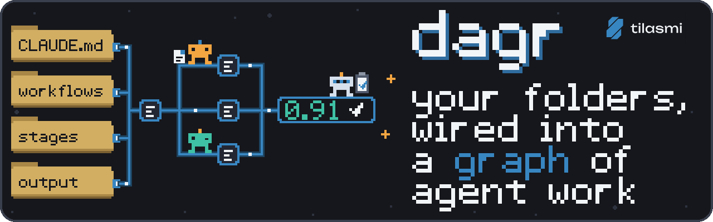
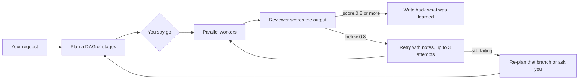

<div align="center">



# dagr

**Turn the ICM folder system you already have into a graph of agent work. Your agent reads this repo, shows you a proposal, and edits your files only after you approve.**


<a href="mailto:shirsho@tilasmi.com"></a>

**Want to work with me?** Email [shirsho@tilasmi.com](mailto:shirsho@tilasmi.com).

</div>

---

## Install

Paste this into your coding agent, from the root of your ICM folder:

```text
Integrate https://github.com/shirshogd/dagr into my ICM
```

That is the whole install. There is no `pip install` and no account.

## What happens when you paste that line

Your agent follows six steps in [`setup/`](setup/CONTEXT.md). Each step is a folder with its own instructions.

1. **Scan** ([01-scan](setup/01-scan/CONTEXT.md)): inventories your tree and writes `.dagr/scan.md`. Nothing is changed.
2. **Map** ([02-map](setup/02-map/CONTEXT.md)): infers what each workflow takes in and puts out, with a confidence level and a list of gaps.
3. **Propose** ([03-propose](setup/03-propose/CONTEXT.md)): writes `.dagr/PROPOSAL.md`. Every file it would add or edit appears as a diff, with the reason and the risk.
4. **Approve** ([04-approve](setup/04-approve/CONTEXT.md)): shows you the proposal and asks. You can answer "approve", "approve except 3", or edit it.
5. **Apply** ([05-apply](setup/05-apply/CONTEXT.md)): applies only what you approved, after copying the originals to `.dagr/backup/<timestamp>/`.
6. **Verify** ([06-verify](setup/06-verify/CONTEXT.md)): runs `dagr doctor` and a dry-run plan on a sample request, then reports.

## Before and after

dagr adds a hidden `.dagr/` folder, five lines of port frontmatter per workflow, one `graph-loop` workflow, and one block in your root agent file. Nothing else moves. The full sample trees are in [`examples/before/`](examples/before/) and [`examples/after/`](examples/after/). Here they are, abridged (`+` marks what dagr added or changed):

```text
BEFORE (examples/before)            AFTER (examples/after)
.                                   .
  CLAUDE.md                           CLAUDE.md                  + one dagr block
  CONTEXT.md                          CONTEXT.md
  inbox/topic.md                      inbox/topic.md
  knowledge/                          knowledge/
    audience.md                         audience.md
    past-topics.md                      past-topics.md
    voice.md                            voice.md
  output/                             output/
    newsletter/draft.md                 newsletter/draft.md
    video-script/script.md              video-script/script.md
  workflows/                          workflows/
    newsletter/                         newsletter/
      CONTEXT.md                          CONTEXT.md             + port frontmatter
      stages/                             stages/
        01-research/CONTEXT.md              01-research/CONTEXT.md
        02-outline/CONTEXT.md               02-outline/CONTEXT.md
        03-draft/CONTEXT.md                 03-draft/CONTEXT.md
    video-script/                       video-script/
      CONTEXT.md                          CONTEXT.md             + port frontmatter
      stages/                             stages/
        01-hook/CONTEXT.md                  01-hook/CONTEXT.md
        02-outline/CONTEXT.md               02-outline/CONTEXT.md
        03-script/CONTEXT.md                03-script/CONTEXT.md
                                      graph-loop/                + added by dagr
                                        CONTEXT.md
                                        reviewer-rubric.md
                                        stages/                  (01-brainstorm ... 07-write-back)
                                    .dagr/                       + added by dagr
                                      config.json
                                      scan.md  ports.md  PROPOSAL.md
                                      engine/                    (copy of the engine)
                                      maps/launch-week/          (sample map: map.md, tickets/T01..T04)
```
## How it works

A **DAG** (directed acyclic graph) is a set of tasks where some wait on others and nothing loops back. dagr turns a request into a DAG, then runs every task whose inputs are ready, at the same time.



A **stage** is one step inside a workflow. A **contract** is the `CONTEXT.md` file that says what a workflow or stage needs. A **port** is a named input or output on a contract (`consumes:` and `produces:`). The planner wires ports together: a stage that produces `draft` feeds any stage that consumes `draft`. More in [how-it-works](docs/how-it-works.md) and [concepts](docs/concepts.md).

> **What is ICM?** Interpretable Context Methodology, from the paper by J. Van Clief and D. McDermott, [arXiv:2603.16021](https://arxiv.org/abs/2603.16021) (MIT licensed). The folder structure is the agent architecture: a root agent file (L0), a routing `CONTEXT.md` (L1), one `CONTEXT.md` per workflow and stage that lists exactly which files to load (L2), reference folders (L3), and `output/` folders (L4). dagr is not part of that paper. It builds on the method.

## Commands

Run these from your root. The long form is `python -B .dagr/engine/dagr/cli.py <command>`; the table writes it as `dagr`.

| Command | What it does |
|---|---|
| `dagr scan [--root R]` | Inventories your tree into `.dagr/scan.json` and `scan.md`. |
| `dagr ports [--root R]` | Lists declared ports, unbound inputs, and mismatches. |
| `dagr doctor [--root R]` | Checks contracts against disk: drift, bad frontmatter, cycles. |
| `dagr plan "<request or workflow id>" [--map SLUG] [--stages] [--no-model]` | Builds a DAG. Writes `map.md` and tickets under `.dagr/maps/SLUG/`. One ticket per workflow; `--stages` makes one per stage. `--no-model` matches keywords only. |
| `dagr go SLUG [--scope T01,T02-T05] [--who NAME]` | Writes `GO.md`. This is your approval. |
| `dagr run SLUG [--dry-run] [--strict-exit] [--worker claude\|codex\|opencode\|custom] [--reviewer-model M] [--no-review] [--max-budget-usd N] [--max-minutes N]` (also `--stall-minutes`, `--max-turns`, `--poll`, `--max-rate-retries`) | Runs ready tickets as headless workers, then reviews them. |
| `dagr status SLUG` | Writes `STATUS.md` and prints the table. State is kept in `.dagr/maps/SLUG/state.json`. |
| `dagr uninstall [--root R] [--yes]` | Restores your originals and removes `.dagr/`. |

## Safety and control

- **Approval gate.** `plan` only writes files. `run` does not start until `GO.md` exists, and `go` is you saying so. `--scope` approves a subset.
- **Setup is a proposal first.** No file in your tree changes until you approve the diff.
- **Backups.** Originals are copied to `.dagr/backup/<timestamp>/` before any edit.
- **Uninstall.** `dagr uninstall` restores the backups and deletes `.dagr/`.
- **Budgets.** `--max-minutes` caps wall-clock time. `--max-budget-usd` caps spend, but only for agents that report cost (the `claude` worker); for the others cost shows as $0.00 and the cap does nothing. Stalled and over-time workers are killed. Rate limits cause a back-off.
- **Humans in the loop.** A ticket marked `needs_human` pauses and writes `questions/Q-T##.md` under the map. You answer in it and set `status: answered`.
- **Nothing deleted.** dagr never deletes, renames, or moves your files. If your root is a git repo, commits cover only the paths a run touched. If it is not, dagr just writes files.

## Status

dagr is new and in **alpha**. So far it has been tested with Claude Code only. Codex, Cursor, OpenCode and other harnesses are supported by design but not yet tested. If you try one, an [integration report](https://github.com/shirshogd/dagr/issues/new/choose) helps a lot.

## More

[FAQ](docs/faq.md) · [How it works](docs/how-it-works.md) · [Concepts](docs/concepts.md) · [Notes per agent](docs/agents.md)

## Contributing

Issues and pull requests are welcome. Keep the engine stdlib-only and compatible with Python 3.9. Run the tests with `python -B -m unittest discover -s engine/tests`. Say what you tried and what you saw.

## License

MIT. See [LICENSE](LICENSE).
